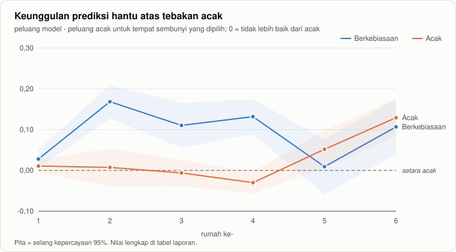
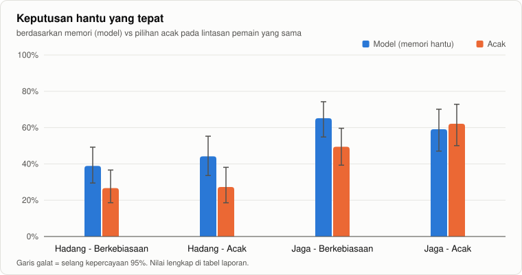

# Hasil Eksperimen "Hantu Belajar" - Haunted House: Hantu yang Mempelajari Ketakutanmu

Dibuat otomatis oleh `Tools > Hantu Belajar > Uji > Eksperimen hantu belajar` (2026-11-20).

## Desain
- **2 kondisi pemain bot x 10 replikasi x 6 rumah**, kesulitan tetap d = 0,60 (bobot belajar hantu 0,69). Memori hantu dikosongkan di awal tiap replikasi lalu dibawa dari rumah ke rumah.
  - **Berkebiasaan**: bot memilih **lemari** pada 85% pelarian bila ada lemari dalam jangkauan - kebiasaan yang bisa dipelajari
  - **Acak**: bot memilih tempat sembunyi **acak** di sekitarnya - tanpa kebiasaan (kontrol)
- Evaluasi **kontrafaktual**: setiap keputusan hantu yang memakai memori dibandingkan dengan pilihan **acak** pada lintasan pemain yang sama (perilaku game tidak diubah).
  - *Prediksi tempat sembunyi*: saat pemain masuk tempat sembunyi, peluang model untuk tempat itu (rata-rata posterior Beta dinormalkan atas tempat sembunyi <= 6 langkah) dibanding peluang acak 1/kandidat. Dihitung sebelum kebiasaan saat itu dicatat.
  - *Hadang*: titik hasil heatmap vs node acak; tepat bila pemain lewat <= 1 sel dari titik itu dalam 25 detik.
  - *Jaga*: tempat hasil Thompson sampling vs tempat acak dari kandidat yang sama; tepat bila pemain sedang/akan (20 detik) bersembunyi di sana.

## 1. Prediksi tempat sembunyi

| Kondisi | Kejadian | Peluang model | Peluang acak | Keunggulan (model - acak) | Uji Wilcoxon (vs 0) | Tebakan pertama tepat (model / peluang) |
|---|---|---|---|---|---|---|
| Berkebiasaan | 213 | 0,618 | 0,511 | 0,107 [0,087; 0,127] | p < 0,001, r = 0,70 | 78% / 51% |
| Acak | 175 | 0,621 | 0,580 | 0,041 [0,023; 0,059] | p < 0,001, r = 0,36 | 73% / 58% |

| Rumah ke- | Berkebiasaan (keunggulan, n) | Acak (keunggulan, n) |
|---|---|---|
| 1 | 0,028 (35) | 0,011 (31) |
| 2 | 0,168 (60) | 0,007 (26) |
| 3 | 0,110 (26) | -0,006 (26) |
| 4 | 0,132 (44) | -0,030 (17) |
| 5 | 0,009 (21) | 0,052 (31) |
| 6 | 0,107 (27) | 0,129 (44) |

## 2. Keputusan hadang dan jaga vs pilihan acak

| Keputusan | Kondisi | Jumlah | Tepat (model) | Tepat (acak) | Uji McNemar eksak |
|---|---|---|---|---|---|
| Hadang | Berkebiasaan | 90 | 35/90 (39%; 29%-49%) | 24/90 (27%; 19%-37%) | p = 0,126 |
| Hadang | Acak | 77 | 34/77 (44%; 34%-55%) | 21/77 (27%; 19%-38%) | p = 0,047 |
| Hadang | *gabungan* | 167 | 69/167 (41%; 34%-49%) | 45/167 (27%; 21%-34%) | p = 0,010 |
| Jaga | Berkebiasaan | 89 | 58/89 (65%; 55%-74%) | 44/89 (49%; 39%-60%) | p = 0,020 |
| Jaga | Acak | 66 | 39/66 (59%; 47%-70%) | 41/66 (62%; 50%-73%) | p = 0,774 |
| Jaga | *gabungan* | 155 | 97/155 (63%; 55%-70%) | 85/155 (55%; 47%-62%) | p = 0,096 |

## Kesimpulan
- **Prediksi tempat sembunyi.** Pada pemain **Berkebiasaan**, prediksi hantu **lebih baik dari acak** (keunggulan rata-rata 0,107, p < 0,001).
- Pada pemain **Acak** (kontrol), keunggulannya 0,041 (p < 0,001), 2,6x lebih kecil daripada pemain berkebiasaan (Mann-Whitney p < 0,001, signifikan (α = 0,05)). Keunggulan kecil yang tersisa wajar: pilihan "acak" bot tetap dibatasi pada tempat yang aman dan terjangkau, dan tempat yang sama bisa terpakai lagi, sehingga ada sedikit pola yang bisa dipelajari. Jadi keunggulan hantu terutama datang dari **kebiasaan pemain**.
- **Jaga** (berjaga di tempat sembunyi yang dicurigai, Thompson sampling): pada pemain Berkebiasaan model lebih tepat 16% daripada acak (p = 0,020, signifikan (α = 0,05)); pada pemain Acak selisihnya -3% (p = 0,774). Penjagaan memang hanya menguntungkan hantu bila pemain punya tempat sembunyi kebiasaan.
- **Hadang** (menunggu di jalur favorit, heatmap jalur): selisih model - acak 12% pada pemain Berkebiasaan (p = 0,126) dan 17% pada pemain Acak (p = 0,047); gabungan 14% (p = 0,010, signifikan (α = 0,05)). Hadang belajar dari **jalur**, bukan tempat sembunyi; kedua bot sama-sama mengejar relik lewat jalur terpendek sehingga sama-sama punya kebiasaan jalur - kondisi Acak bukan kontrol untuk hadang.

Catatan: hantu tidak pernah menemukan pemain yang sedang bersembunyi (desain game); "tepat" berarti tebakan hantu menunjuk tempat/jalur yang memang dipakai pemain, yang membuat hadangan dan penjagaan terasa "cerdas".

Data per kejadian: `Hasil_Eksperimen_Belajar.csv`.
