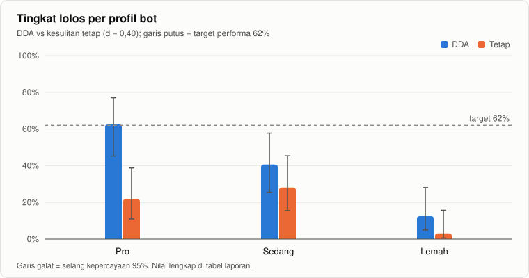
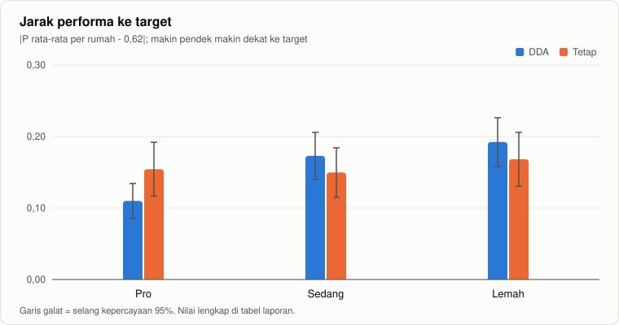
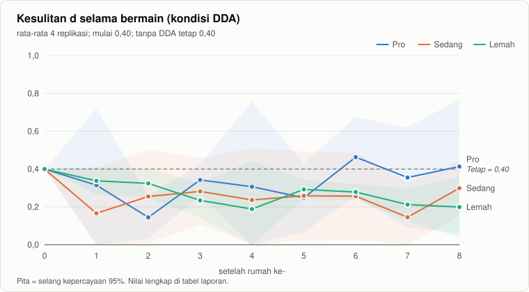
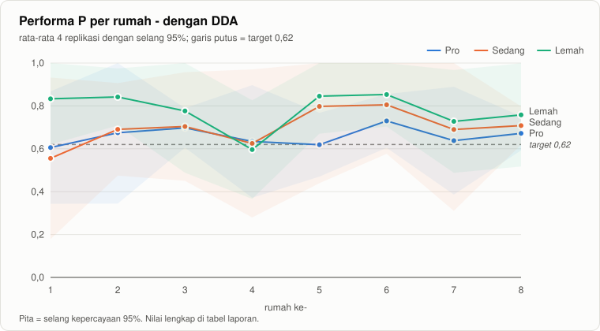
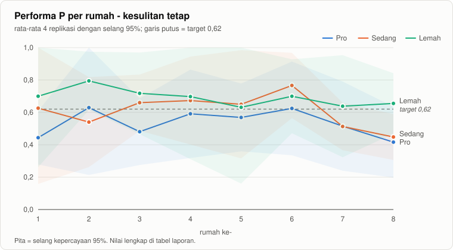

# Hasil Eksperimen DDA - Haunted House: Hantu yang Mempelajari Ketakutanmu

Dibuat otomatis oleh `Tools > Hantu Belajar > Uji > Eksperimen DDA` (2026-11-20).

## Desain
- **3 profil bot x 2 kondisi x 4 replikasi x 8 rumah = 192 rumah.** Kondisi **DDA** (kesulitan d menyesuaikan) dibandingkan dengan **Tetap** (d = 0,40 sepanjang permainan).
- Tiap replikasi mulai dari d = 0,40 dengan memori hantu kosong. Seed rumah sama untuk DDA dan Tetap (rumah pertama identik; rumah berikutnya bisa berbeda karena DDA mengubah parameter PCG).
- Bot memainkan game sungguhan (fisika, AI hantu, PCG) dengan skala waktu x16 tanpa grafis. Batas 420 detik (7 menit) permainan per rumah; lewat batas dihitung gagal.
- Profil bot (`AutoPilot`), dibedakan oleh persepsi, reaksi, dan keputusan (navigasi & penghindar perabot sama untuk semua): **Pro** sadar dikejar dari 18 m / terlihat dari 11 m, langsung bereaksi, berlari saat hantu jauh sambil menyisakan stamina, mengendap bila hantu dekat tetapi membelakangi, memilih tempat sembunyi aman yang jarang dicurigai hantu; **Sedang** sadar dari 13 m / 8 m, bereaksi 0,45 dtk, sesekali ragu atau salah jalan, tempat sembunyi aman terdekat; **Lemah** sadar dari 10 m / 6 m, bereaksi 0,8 dtk, sering ragu dan salah jalan, panik berlari (berisik, stamina cepat habis) saat hantu dekat, kembali ke tempat sembunyi favorit walau berisiko dan keluar terlalu cepat. Kalibrasi tanpa DDA: `TestOutput/kalibrasi_bot.txt`.
- Ukuran: tingkat lolos (selang Wilson 95%), indikator performa DDA **P** (0-1, dihitung tiap 8 detik di kedua kondisi) dirata-rata per rumah dan jaraknya ke target **0,62**, serta kesulitan d.

## 1. Tingkat lolos per profil

| Profil | DDA: lolos (95% CI) | Tetap: lolos (95% CI) | Uji Fisher eksak |
|---|---|---|---|
| Pro | 20/32 (63%; 45%-77%) | 7/32 (22%; 11%-39%) | p = 0,002 |
| Sedang | 13/32 (41%; 26%-58%) | 9/32 (28%; 16%-45%) | p = 0,430 |
| Lemah | 4/32 (13%; 5%-28%) | 1/32 (3%; 1%-16%) | p = 0,355 |

**Selisih Pro - Lemah** (makin kecil = kesulitan makin menyesuaikan kemampuan): Tetap **19%**, DDA **50%**; pengecilan selisih -31% (bootstrap 95%: -56% s.d. -6%).

## 2. Kedekatan performa ke target (|P rata-rata - 0,62| per rumah, makin kecil makin baik)

| Profil | DDA | Tetap | Mann-Whitney U |
|---|---|---|---|
| Pro | 0,110 [0,086; 0,134] | 0,154 [0,117; 0,192] | p = 0,104, r = -0,20 |
| Sedang | 0,173 [0,140; 0,206] | 0,150 [0,115; 0,184] | p = 0,460, r = 0,09 |
| Lemah | 0,192 [0,158; 0,226] | 0,168 [0,131; 0,206] | p = 0,292, r = 0,13 |
| **Semua** | 0,158 [0,140; 0,177] | 0,157 [0,137; 0,178] | p = 0,913, r = 0,01 |

## 3. Perjalanan kesulitan d pada kondisi DDA

| Setelah rumah ke- | Pro | Sedang | Lemah |
|---|---|---|---|
| 0 | 0,40 | 0,40 | 0,40 |
| 1 | 0,32 | 0,17 | 0,34 |
| 2 | 0,14 | 0,26 | 0,32 |
| 3 | 0,34 | 0,28 | 0,23 |
| 4 | 0,31 | 0,24 | 0,19 |
| 5 | 0,25 | 0,26 | 0,29 |
| 6 | 0,46 | 0,26 | 0,28 |
| 7 | 0,36 | 0,15 | 0,21 |
| 8 | 0,41 | 0,30 | 0,20 |

## 4. Performa P per rumah dibanding target 0,62

P = indikator performa DDA (0 = sangat tertekan, 1 = sangat unggul), rata-rata per rumah. Pada kondisi DDA, P pemain kuat seharusnya turun dan P pemain lemah naik mendekati 0,62; pada kondisi Tetap tidak ada yang menariknya.

| Rumah ke- | Pro DDA | Sedang DDA | Lemah DDA | Pro Tetap | Sedang Tetap | Lemah Tetap |
|---|---|---|---|---|---|---|
| 1 | 0,61 | 0,56 | 0,83 | 0,44 | 0,63 | 0,70 |
| 2 | 0,67 | 0,69 | 0,84 | 0,63 | 0,54 | 0,79 |
| 3 | 0,70 | 0,70 | 0,78 | 0,48 | 0,66 | 0,72 |
| 4 | 0,63 | 0,63 | 0,60 | 0,59 | 0,67 | 0,70 |
| 5 | 0,62 | 0,80 | 0,85 | 0,57 | 0,65 | 0,63 |
| 6 | 0,73 | 0,81 | 0,85 | 0,62 | 0,77 | 0,70 |
| 7 | 0,64 | 0,69 | 0,73 | 0,52 | 0,51 | 0,64 |
| 8 | 0,67 | 0,71 | 0,76 | 0,42 | 0,45 | 0,66 |

## Kesimpulan
- **Keterampilan bot (tanpa DDA).** Tingkat lolos Pro / Sedang / Lemah = 22% / 28% / 3%; relik terkumpul 82% / 83% / 52%; lama bertahan sebelum tertangkap 165 / 168 / 73 dtk. Pro dan Sedang tidak terpisah pada tingkat lolos (Fisher p = 0,774) maupun pada relik dan lama bertahan - keduanya setara sebagai pemain cakap. Lemah jelas paling lemah (Sedang vs Lemah p = 0,013).
- **Kesulitan menyesuaikan pemain.** Dari awal 0,40, kesulitan akhir dengan DDA: Pro 0,41 (hampir tetap), Sedang 0,30 (turun), Lemah 0,20 (turun) - urutannya mengikuti keterampilan: makin lemah pemain, makin besar penurunan kesulitan.
- **Tingkat lolos.** DDA menaikkan tingkat lolos Pro 22% -> 63% (p = 0,002), Sedang 28% -> 41% (p = 0,430), Lemah 3% -> 13% (p = 0,355). Sebagai pembanding kasar, tingkat lolos 3 dari 3 profil lebih dekat ke 62% dengan DDA.
- **Kesenjangan Pro - Lemah** membesar dengan DDA (19% -> 50%; bootstrap 95% untuk pengecilan: -56% s.d. -6%). Kesulitan tetap d = 0,40 ternyata terlalu sulit untuk semua profil (semua di bawah 62%), sehingga DDA menurunkan kesulitan untuk semua; profil yang paling mampu memanfaatkan hantu yang lebih mudah (Pro) paling diuntungkan. Lemah tetap sering tertangkap walau kesulitan sudah rendah - penurunan per rumah dibatasi 0,30 dan kelemahannya (reaksi lambat, panik berlari) tidak bergantung pada kecepatan hantu.
- **Indikator performa P.** Jarak P ke target 0,62: DDA 0,158 vs Tetap 0,157 (p = 0,913, tidak signifikan). Penyebabnya terlihat di data: rata-rata P rumah yang berakhir **tertangkap** (0,71) tidak lebih rendah daripada rumah yang **lolos** (0,68; Mann-Whitney p = 0,083). Penangkapan biasanya terjadi tiba-tiba setelah jendela evaluasi 8 detik yang tenang, sehingga P per rumah tidak mencerminkan kegagalan - terutama untuk pemain lemah yang cepat tertangkap. DDA tetap menyesuaikan lewat kejadian tertangkap (-0,15) dan lolos (+0,08), itulah yang menggerakkan kesulitan di atas. Perbaikan yang disarankan: masukkan kejadian tertangkap dan tingkat bahaya (jarak hantu, waktu sejak terakhir dikejar) ke dalam P.

Keterbatasan: bot bukan manusia (tidak merasa takut, tidak belajar dari pengalaman), jadi eksperimen ini menguji **mekanisme** DDA. Klaim tentang pengalaman pemain memerlukan uji coba pemain (`Tools > Hantu Belajar > Analisis Data Uji Coba`, lihat `PROTOKOL_UJI_COBA.md`).

Data per rumah: `Hasil_Eksperimen_DDA.csv`.
